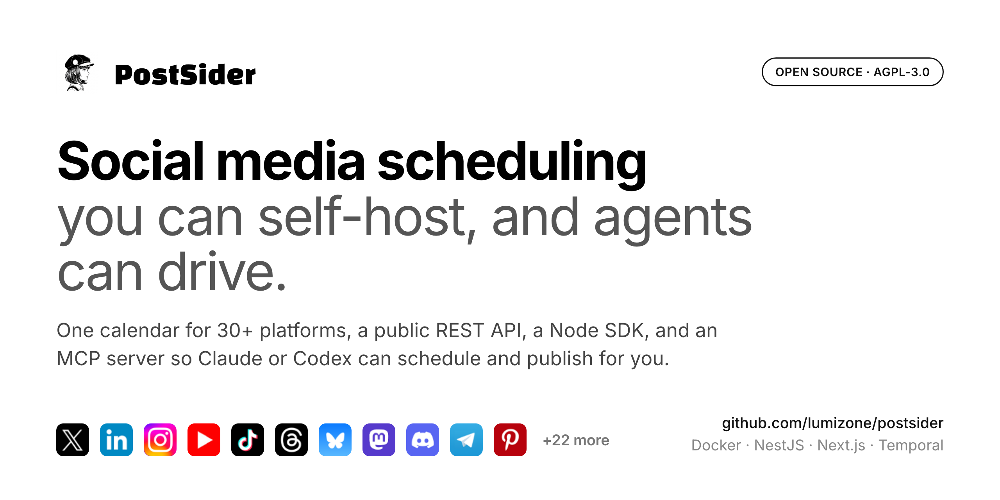

<p align="center">
  
</p>

<h1 align="center">PostSider</h1>

<p align="center">
  <strong>Open-source social media scheduling for humans, teams, and AI agents.</strong>
</p>

<p align="center">
  Schedule and publish across <strong>33 built-in connectors</strong> from one calendar.<br/>
  Self-host with Docker, automate through the REST API and Node.js SDK, or connect AI agents through MCP.
</p>

<p align="center">
  <a href="https://postsider.com"><strong>Website</strong></a>
  ·
  <a href="https://docs.postsider.com"><strong>Documentation</strong></a>
  ·
  <a href="#quick-start"><strong>Quick Start</strong></a>
  ·
  <a href="#ai-agents-mcp"><strong>MCP</strong></a>
  ·
  <a href="#public-api--sdk"><strong>API & SDK</strong></a>
</p>

<p align="center">
  <a href="https://github.com/lumizone/postsider/actions/workflows/ci.yml"></a>
  <a href="https://github.com/lumizone/postsider/releases"></a>
  <a href="https://github.com/lumizone/postsider/stargazers"></a>
  <a href="LICENSE"></a>
  <a href="#self-hosting"></a>
  <a href="apps/mcp/README.md"></a>
</p>

<p align="center">
  
</p>

---

## What is PostSider?

PostSider is an open-source social media management and scheduling platform built around four ways of working:

| Use PostSider as | What you get |
|---|---|
| **Social media scheduler** | One calendar for planning, composing, approving, scheduling, and publishing content |
| **Self-hosted platform** | A Docker-based deployment you can run on your own infrastructure |
| **Automation backend** | A public REST API plus the `@postsider/node` SDK |
| **AI-agent bridge** | An MCP server that lets compatible agents work with PostSider through structured tools |

PostSider ships with **33 active connectors** registered in the application. You configure credentials only for the platforms you actually use.

AI features are optional. PostSider works without an OpenAI API key.

---

## Quick Start

For a local evaluation, the fastest path is Docker Compose.

### Requirements

- Docker
- Docker Compose

### Start PostSider

```bash
git clone https://github.com/lumizone/postsider.git
cd postsider
docker compose up -d
```

The default Compose stack pulls:

```text
ghcr.io/lumizone/postsider-app:latest
```

and starts PostSider with PostgreSQL, Redis, and Temporal.

Open:

```text
http://localhost:4007
```

Create the first administrator account:

```bash
docker exec -it postsider pnpm bootstrap
```

The bootstrap command prints a one-time password. Sign in with:

```text
admin@setup.local
```

and the generated password. PostSider then prompts you to set your real email address and password.

> The root `docker-compose.yaml` is convenient for local evaluation. For an internet-facing deployment, use the production setup and the [self-hosting guide](https://docs.postsider.com/self-hosting).

---

## Highlights

### Scheduling and publishing

- Visual calendar with drag-and-drop scheduling
- Posting queue and find-free-slot scheduling
- Smart Slot suggestions
- Evergreen content recycling
- Per-platform previews
- Per-platform validation before publishing
- Automatic first comments where supported
- Bulk CSV import

### Content workflow

- Hashtag groups
- Caption templates
- Reusable snippets
- UTM builder
- Draft and approval workflows
- Shared media library

### Teams and organizations

- Multi-organization workspaces
- Separate workspaces for brands or clients
- Admin and User roles
- Shared publishing workflow

### Automation

- [Agent publishing safety, scoped-key permissions and MCP verification](docs/API-MCP-TRUST.md)
- Public REST API
- Node.js SDK: `@postsider/node`
- MCP server: `@postsider/mcp`
- Webhooks
- Programmatic scheduling and channel access

### Optional AI

- Post Checker
- Caption rewriting
- Platform-level `OPENAI_API_KEY`
- Per-organization bring-your-own key support

### Security

- Optional TOTP two-factor authentication
- One-time recovery codes
- Organization-wide 2FA enforcement
- Encrypted provider credentials at rest
- Security activity trail
- Secure `httpOnly` cookies
- CORS and CSP controls
- Rate limiting
- Server-side authorization and plan enforcement

---

## Supported Platforms

The list below mirrors the active providers registered in:

[`libraries/nestjs-libraries/src/integrations/integration.manager.ts`](libraries/nestjs-libraries/src/integrations/integration.manager.ts)

| Category | Platforms |
|---|---|
| **Social & creator platforms** | X, LinkedIn Profile, LinkedIn Page, Facebook, Instagram via Facebook, Instagram Standalone, Threads, YouTube, TikTok, Pinterest, Bluesky, Mastodon, Nostr, Farcaster, Lemmy, Twitch, Dribbble, Google Business Profile, Whop, Moltbook |
| **Chat & community** | Discord, Slack, Telegram |
| **Blogs & publishing** | Dev.to, Hashnode, Medium, WordPress, Ghost, Blogger, Notion, Mataroa, Write.as, Listmonk |

That is **33 active connectors** in the current integration registry.

You only need OAuth/API credentials for the providers you intend to use. See:

- [`.env.example`](.env.example)
- [Channel configuration](https://docs.postsider.com/channels/overview)
- [Environment configuration](https://docs.postsider.com/configuration/environment)

Mastodon supports custom instances through the standard Mastodon provider.

### Adding a provider

Provider integrations live in:

```text
libraries/nestjs-libraries/src/integrations/social/
```

A new connector typically:

1. Extends `SocialAbstract`
2. Implements `SocialProvider`
3. Is registered in `socialIntegrationList` in `integration.manager.ts`
4. Adds the corresponding frontend platform metadata/assets

New provider integrations are especially welcome as pull requests.

---

## AI Agents (MCP)

PostSider includes an MCP server for compatible AI clients and agents.

The package is:

```text
@postsider/mcp
```

The MCP layer is a thin interface over PostSider's public API and exposes **40 tools** on the hosted server, 41 on the local stdio server, and 42 on the local stdio server when you opt in to approval decisions (see "Approvals" below), for workflows such as:

- Listing connected channels
- Reviewing the publishing calendar
- Creating drafts
- Requesting approval
- Uploading media
- Working with scheduled content
- Reading analytics

The intended workflow is **read-first and draft-first**: an agent can prepare work inside the same PostSider workflow used by humans, while publishing remains a deliberate action.

### Build the MCP server

```bash
pnpm --filter @postsider/mcp build
```

For a local/stdio connection, configure:

```text
POSTSIDER_API_KEY
POSTSIDER_API_URL
```

`POSTSIDER_API_URL` points the MCP server at the PostSider instance you want to use.

Full MCP documentation:

- [`apps/mcp/README.md`](apps/mcp/README.md)
- [Hosted MCP walkthrough](https://docs.postsider.com/cloud/mcp)

### Claude Code plugin

This repository also contains the Claude Code plugin metadata and five skills: postsider-agency-operations, postsider-approval-workflow, postsider-calendar-review, postsider-content-publishing and postsider-performance-reporting.

```bash
claude plugin marketplace add lumizone/postsider
claude plugin install postsider@postsider
```

A safe read-only connection check:

```text
List my connected PostSider channels. Do not create or modify anything.
```

### Webhooks

Webhook subscriptions are managed under `/public/v1/webhook-subscriptions` and receive these events: `post.published`, `post.failed`, `approval.requested` and `approval.resolved`. The `webhook.test` event is sent only by the test endpoint described below.

Every delivery is a JSON POST with this envelope:

```json
{ "id": "...", "event": "post.failed", "createdAt": "...", "organizationId": "...", "data": {} }
```

For `post.failed`, `data` contains `postId`, `error`, `errorCategory`, `errorRetryable` and `post`. `errorCategory` can be `POLICY_BLOCKED`, which means a policy rule stopped the post at publish time (see "Policies and key limits").

Each request carries these headers: `X-Postsider-Event`, `X-Postsider-Event-Id`, `X-Postsider-Timestamp`, `X-Postsider-Signature` and `X-Webhook-Attempt`. The signature is `HMAC-SHA256` over `<timestamp>.<raw body>` computed with the subscription secret, sent as `sha256=<hex>`. Verify it against the raw request body before parsing.

Delivery is at least once, so receivers must dedupe on the event id. A failed delivery is retried after 1 minute, 5 minutes, 30 minutes, 2 hours, 6 hours and 12 hours, which makes 7 attempts in total. After the last attempt the delivery is marked `FAILED`. Responses with a 4xx status other than 429 are not retried. A subscription is deactivated after 10 consecutive failed deliveries.

Delivery log, replay and test routes:

- `GET /public/v1/webhook-subscriptions/:id/deliveries` lists deliveries (scope `webhooks:read`).
- `POST /public/v1/webhook-subscriptions/:id/deliveries/:deliveryId/replay` queues a delivery again (scope `webhooks:write`).
- `POST /public/v1/webhook-subscriptions/:id/test` sends a `webhook.test` event (scope `webhooks:write`).

Deliveries are kept for 30 days and idempotency keys for 7 days.

To retry the failed posts of a group, call `POST /public/v1/posts/group/:group/retry-failed` (scope `posts:write`, optional `Idempotency-Key` header). Posts whose `errorCategory` is `UNKNOWN_OUTCOME` may already have been published on the provider, so they are skipped unless the body sets `includeUnknownOutcome` to `true`. The MCP tool `postsider_retry_failed_posts` wraps this route.

### Who did what: actor, claimed provenance and audit events

Every post records two different things about who touched it.

- **Verified actor.** The server sets `createdBy*` and `lastModifiedBy*` (type plus `UserId`, `ApiKeyId` or `OAuthClientId`) from the credential that made the call. The type is one of `USER`, `API_KEY`, `OAUTH_CLIENT` or `SYSTEM`. An OAuth client actor also records the user who authorized it. The actor cannot be supplied in a request, and `creationMethod` is a hint only: it never changes the actor. Rows created before this feature have null actor columns. New writes made with a legacy organization key record an `API_KEY` actor without an id.
- **Claimed provenance.** Callers may describe their own run with the `provenance` body object on `POST /public/v1/posts` and `PUT /public/v1/posts/:id`, using `agentName`, `workflowId`, `runId`, `externalRef` and `source`, or with the headers `X-Postsider-Agent`, `X-Postsider-Workflow-Id`, `X-Postsider-Run-Id`, `X-Postsider-External-Ref` and `X-Postsider-Source`. Each value is at most 255 characters, and a body field wins over its header. Never put prompts or post content in it. Treat it as untrusted text: it is a claim, never proof of identity.

`GET /public/v1/audit-events` lists audit events for the organization, newest first (scope `audit:read`, which is never granted by default, so add it to a key on purpose). Filters are `targetType`, `targetId`, `type`, `from` and `to`; `limit` is 1 to 100 (default 25) and `nextCursor` from a page goes back in as `cursor`. `GET /public/v1/posts/:id/activity` returns the same events for one post group, including after deletion (scope `posts:read`; the MCP tool `postsider_get_post_activity` wraps it). The eleven event names are `post.created`, `post.updated`, `post.deleted`, `post.status_changed`, `post.approval_requested`, `post.approval_resolved`, `post.published`, `post.failed`, `post.retry_requested`, `post.policy_evaluated` and `policy.changed`. Event metadata holds small facts and never post content. The `post.published`, `post.failed`, `approval.requested` and `approval.resolved` webhook payloads carry `actor` and `provenance` fields.

Retention and impersonation: resource audit events are kept for 365 days, and the daily retention job never purges security or sign-in rows. When a super admin impersonates a user (only possible where impersonation is enabled with `ALLOW_SUPERADMIN_IMPERSONATION=true`), the recorded actor is the impersonated user, and the events carry `metadata.impersonatedBy` with the super admin id. This is a known residual, documented rather than fixed.

### Approval requests

`POST /public/v1/posts/:id/request-approval` (MCP tool `postsider_request_approval`) is idempotent. A new request returns HTTP 201 with `created: true`. If an approval is already pending, it returns that approval with HTTP 200 and `created: false`, and reviewers are not notified again. The response never includes the `guestToken`. Approvals record who requested and who decided them. Guest reviewers give a name and email, so the guest review page asks for both. These are self-asserted, not verified: anyone holding the guest link can type any identity, so treat `decidedBy.type = GUEST` as a claim. The `GUEST_REVIEW_REQUIRE_IDENTITY` environment variable exists only to order a deploy (backend and frontend ship separately): it defaults to on, and `false` lets decisions without identity through while an old page is still served.

### Approvals (stages, flows, links)

**Stages and flows.** An approval can have one stage or up to five. A *flow* is an ordered list of stages, and each stage names who may decide it: a minimum role (`ADMIN` or `SUPERADMIN`; a plain `USER` can never decide), an optional list of named members, and two switches, `allowAutomation` (an API key may decide) and `allowGuest` (a guest link may decide). A post goes through the stages in order. Approving a stage that is not the last one keeps the approval `PENDING` and the post in approval, and the next stage's approvers are notified. Only approving the last stage schedules the post. A rejection at any stage ends the approval as `REJECTED` and returns the post to draft. An organization can have 20 live flows. Flows are managed by admins in Settings, Approval flows, or through `/public/v1/approval-flows` (`GET`, `GET /:id`, `POST`, `PUT /:id`, `DELETE /:id` which archives; scopes `policies:read` and `policies:write`). An archive is refused with `flow_in_use` while an enabled rule points at the flow.

**How a rule picks a flow.** A `REQUIRE_APPROVAL` policy rule can carry an `approvalFlowId`. When a post is routed to approval, the flow of the first matching rule that has one is used (rules run in priority order). If no matching rule names a flow, the organization's default flow is used. If there is no default flow either, the approval has a single implicit stage that behaves exactly like before Phase 5: any admin may approve, automation and guests are allowed, and a solo owner can approve their own post. The stage definitions are copied onto the approval when it is requested, so editing or archiving a flow does not change the stages of an approval already in progress.

**Who can decide.** A human must be an enabled member whose role meets the stage's minimum, and, when the stage lists members, be one of them (a `SUPERADMIN` is exempt from the list so a stage cannot deadlock when listed members leave). Two flow flags, both on by default for flows you create, restrict humans further: `preventSelfApproval` (the decider may not be the post's creator or the requester) and `requireDistinctApprovers` (whoever decided an earlier stage cannot decide a later one). A `SUPERADMIN` is never exempt from these two. A solo owner who needs to approve their own posts turns the flags off on the flow, or uses no flow at all. Automation never decides an approval it requested or a post it created, with no flag to change that. Important: the two flags are read from the flow row at decision time and are not copied onto the approval, so changing a flag on a flow affects approvals that are already in flight. (If a flow is hard deleted, the strict defaults apply.) Stage definitions, by contrast, are a snapshot.

**Deciding with an API key.** `POST /public/v1/approvals/:id/approve` and `/reject` need the scope `approvals:decide`. It is never in a default scope set, existing keys do not have it, it cannot be granted to OAuth or MCP tokens, and it does not allow editing flows. Because approving schedules the post, a key limited by key limits must also be allowed `SCHEDULE` on the post's channel, so a draft-only key cannot approve. The stage must have `allowAutomation` on. `GET /public/v1/approvals` (scope `approvals:read`) lists approvals as `{ "approvals": [...], "nextCursor": "..." }` with `status`, `limit` (1 to 100), `cursor` and `since` filters, and `GET /public/v1/approvals/:id` returns one item with a plain-text preview.

```bash
curl -X POST "$POSTSIDER_API_URL/public/v1/approvals/$APPROVAL_ID/approve" \
  -H "Authorization: $POSTSIDER_API_KEY" \
  -H "Content-Type: application/json" \
  -H "Idempotency-Key: approve-$APPROVAL_ID-stage-1" \
  -d '{ "note": "Checked the claims and the link." }'
```

The answer is `{ approvalId, postId, status, changed, stage: { position, total }, final }`. Repeating the same decision returns 200 with `changed: false`. The opposite decision after a decision is `409 approval_already_resolved`. A refused key gets `403` with `not_allowed_for_stage` or `self_approval_blocked`. Every decision is attributed to the key in the audit trail and on the stage.

**Email approver links.** Off by default. Set `APPROVAL_EMAIL_LINKS=true` and each eligible approver receives a personal "Review and approve" and "Review and reject" link by email instead of the plain notification. The link lives for `APPROVAL_LINK_TTL_HOURS` (default 48, range 1 to 168), needs no login, and works once. Opening it only shows the post: the decision needs a second click on the page, which is protected by a short-lived challenge (it is accepted from 2 seconds to 15 minutes after the page loaded), so a mail scanner that fetches the link cannot decide. The decision is recorded as the member the email was sent to, whose membership, role and stage eligibility are checked again at that moment. Five failed attempts revoke the link. Be clear about what this means: whoever holds the email can decide as that member until the link is used or expires, so a forwarded email is a real risk. Enable it knowingly. Details are in [`docs/API-MCP-TRUST.md`](docs/API-MCP-TRUST.md).

- A link email is not sent to members who could not use it (for example the post's creator when `preventSelfApproval` is on).
- If `JWT_SECRET` or `FRONTEND_URL` is missing, links cannot be built and PostSider sends the plain notification email instead.
- A decision made in the dashboard or through the API leaves the unused email links in place until they expire, but they are inert: they answer `409 approval_already_resolved`.

**Guest links.** An admin can still create a guest review link for a pending approval. A link is only possible when the current stage has `allowGuest` on (`400 guest_not_allowed_for_stage` otherwise). A guest link is single use: if a guest approves a stage that is not the last one, the link is consumed and an admin must create a new link for the next stage. Guest names and emails are self-asserted. Guest links are stored as a SHA-256 hash, and the dashboard no longer returns any token material (see the security note in `docs/API-MCP-TRUST.md`).

**MCP.** The tool `postsider_decide_approval` exists only on the local stdio server and only when `POSTSIDER_MCP_ALLOW_APPROVAL_DECISIONS=true` is set (exactly `true`). The hosted OAuth MCP server cannot decide approvals. It uses the same API route and needs a key with `approvals:decide`.

**Workspaces (customers).** `GET /public/v1/customers` (scope `channels:read`), `POST /public/v1/customers`, `PUT /public/v1/customers/:id` and `POST /public/v1/customers/:id/archive` (scope `channels:write`, admin caller) create, rename and archive named channel groups, up to 200 per organization. Archiving detaches the channels and keeps the posts. `PUT /public/v1/integrations/:id/customer` accepts a `customerId`. There is no audit event for these changes, and the name and cap checks are soft, so two simultaneous creates can race. Creating organizations or inviting members is not available through the API.

### Slack, Make and Zapier

**Slack (notify only).** Register a Slack incoming webhook URL as an ordinary webhook subscription. PostSider recognizes `https://hooks.slack.com/services/...` and sends Slack's message format instead of the usual envelope.

```bash
curl -X POST "$POSTSIDER_API_URL/public/v1/webhook-subscriptions" \
  -H "Authorization: $POSTSIDER_API_KEY" \
  -H "Content-Type: application/json" \
  -d '{
    "name": "Slack approvals",
    "url": "https://hooks.slack.com/services/T000/B000/XXXX",
    "events": ["approval.requested", "approval.resolved", "post.failed"]
  }'
```

The message is one line (for example "A post is waiting for approval (stage 1 of 2: Reviewer).") plus a link button to the PostSider approval or agent activity page. It deliberately contains no post text, no media, and no ids or names of people, because a Slack channel can include people who are not PostSider users. The button leads to a login-gated page, so nobody can decide from Slack. There are no interactive Approve buttons, no reminders and no automatic expiry: a message cannot be recalled when a stage is decided somewhere else. The Slack URL is a secret; PostSider keeps it out of stored delivery errors and logs.

**Make.** [`docs/automation/make.md`](docs/automation/make.md) has recipes built from the Webhooks and HTTP modules. They are written from the API contract and have not been tested against a live Make account.

**Zapier.** [`docs/automation/zapier.md`](docs/automation/zapier.md) and the scaffold in [`examples/automation/zapier`](examples/automation/zapier) (two triggers, three actions, tested mapping code). The scaffold has not been validated or pushed: `zapier-platform-core` is not installed in this repository, so `zapier validate` is still to do, and nothing was submitted to Zapier.

**n8n.** The `n8n-nodes-postsider` package version 0.2.0 adds approval, policy check and group operations and an approval-to-Slack example. It is not published. The scopes table in its README is partly assumed from the API contract and should be checked against a real server before release.

### Policies and key limits

Two separate controls limit what an automation can do. Both are off until an owner sets them, so existing keys and workspaces behave as before.

**Key limits.** A named API key can carry two limits, set through the key settings (`allowedActions` and `allowedIntegrationIds` on `POST /settings/api-keys` and `PUT /settings/api-keys/:id`).

- `allowedActions` is a list of `DRAFT`, `SCHEDULE` and `PUBLISH_NOW`. A key limited to `DRAFT` cannot schedule or publish.
- `allowedIntegrationIds` is a list of channel ids (at most 100). A key with channel limits can only create, edit, schedule, retry and duplicate posts on those channels. Limits do not cover deleting posts, requesting approval, uploading media, or channel administration (disabling, enabling, deleting or reassigning channels and running channel tools with `channels:write`): the key can still use those on other channels.
- An empty list means unrestricted. Legacy organization keys and OAuth or MCP OAuth tokens are not limited by key limits.
- A refused request answers `403` with `key_action_not_allowed` or `key_channel_not_allowed` before anything is written or an idempotency key is claimed. One forbidden channel refuses the whole request.

**Policy rules.** An organization can define rules under `/public/v1/policies`. A rule has a condition, an effect (`REQUIRE_APPROVAL` or `BLOCK`), a priority (0 to 1000, lower runs first) and optional filters by actor type, API key, channel or provider. An organization can have at most 50 enabled and 200 stored rules (`policy_limit_reached` when exceeded). Rule names are 1 to 120 characters.

| Condition | Params | Matches when |
| --- | --- | --- |
| `ALWAYS` | none | every evaluated post |
| `CONTAINS_LINK` | none | the text holds an http or https URL, a `www.` host, a bare domain with a common TLD, or a link target |
| `CONTAINS_WORDS` | `words`: 1 to 100 entries of 1 to 100 characters | any whole word or phrase appears, ignoring case |
| `OUTSIDE_WINDOW` | `days` (0 is Sunday to 6), `start` and `end` as `HH:MM`, `timezone` (canonical IANA name) | the scheduled time is outside the window on a listed day; an `end` before `start` crosses midnight |
| `DAILY_CAP_EXCEEDED` | `max` (1 to 10000), `scope` (`organization` or `channel`), optional `timezone` (default UTC) | this post would be more than `max` posts that day |
| `PUBLISH_NOW` | none | the write publishes immediately |
| `HAS_VIDEO` | none | the post carries a video file (mp4, webm, mov, mkv, m4v, avi) |

Effects: `REQUIRE_APPROVAL` writes the post as a draft and requests a human approval. `BLOCK` refuses the write with `422 policy_blocked` and, at publish time, fails the post with `errorCategory: POLICY_BLOCKED` (not retryable). BLOCK beats REQUIRE_APPROVAL. A post that already has an approved approval satisfies `REQUIRE_APPROVAL` rules, but never a `BLOCK` rule.

Who a rule applies to: with no actor filter a rule applies to automation only (`API_KEY` and `OAUTH_CLIENT`). `USER` and `SYSTEM` are covered only when listed. A rule that lists `USER` is also applied when a person saves in the dashboard (see Agent activity below); other dashboard write paths are covered at publish time only.

**Write time and publish time.** Rules are checked when the public API or MCP creates, edits, schedules or retries a post, and again just before a post is sent to the platform. Responses to create, update, status change and retry carry `policy: { effect, matched }` (create and update add it to every array element, together with `approvalRequested`). Each non-ALLOW outcome is recorded as the `post.policy_evaluated` audit event, and each rule change as `policy.changed`.

**Dry run.** `POST /public/v1/policies/evaluate` takes the create body shape and returns `{ effect, matched, channels, key }` for the calling credential, and writes nothing. MCP exposes it as `postsider_check_policy`.

**Scopes.** `policies:read` lists and reads rules and `policies:write` creates, changes and deletes them. Neither is granted by default, and neither can be granted to OAuth or MCP tokens. The dry run needs only `posts:read`.

**Error codes.** `key_action_not_allowed` and `key_channel_not_allowed` (403), `policy_blocked` (422), `policy_input_too_large` (400, content too large to evaluate; at publish time it blocks the post) and `policy_limit_reached` (400, rule limit).

**Honest limits.** Read these before relying on rules as a control.

- Drafts are reported, not enforced, at write time. The same rules still apply when the draft is scheduled or published, and a BLOCK rule stops it at publish time.
- Rules read the text of the post (and link targets). They do not look inside images or video, follow redirects, or understand meaning.
- Dashboard saves are checked at write time only for the composer (create, edit, schedule), rescheduling a post by drag, and the places listed under Agent activity. CSV import, duplicate, approve, resuming a pause and evergreen recycling are not checked when written. They are caught at publish time.
- Workflows started before v1.0.9 skip the publish-time check until they run.
- Approvals carry no content version. An approval granted for older content is still honored at publish time after a dashboard edit.
- An API edit or reschedule of an approved queued post sends it back to approval.
- A BLOCK rule that matches an already `PUBLISHED` repeat child post flips that post to `ERROR`, and its repeat schedule ends.
- When a `REQUIRE_APPROVAL` rule holds the repeat of an already `PUBLISHED` post, the post stays `PUBLISHED`, no approval is requested, no notification is sent and the repeat schedule stops for good. Only the `post.policy_evaluated` audit event records it.
- Posts are evaluated at the moment they will really go out. A stored date in the past counts as now, so `OUTSIDE_WINDOW` and `DAILY_CAP_EXCEEDED` use the real publish time and day for late approvals, retries and resumed pauses.
- Scheduling a post that is already in `APPROVAL` answers 200 with state `APPROVAL` when a `REQUIRE_APPROVAL` rule matches, 422 when a BLOCK rule matches, and 400 otherwise.
- An edit to a channel that needs approval is written as a draft and waits for approval.
- `retry-failed` sends matching rows to approval (result action `approval_requested`) instead of re-queuing them.
- Repeating an idempotent create after a failure in the approval router can leave duplicate drafts.
- Daily caps are best effort and count only posts created by an API key or OAuth client. Two simultaneous writes can both pass.
- Internal plugs (for example `x-repost-post-users` and `plug-<name>--integrations` entries in post settings) post to other channels with no policy check and no key check. Channel or provider scoped rules and key channel limits do not cover plug targets. This is a known limit of v1, out of scope for now.
- A key with `policies:write` can disable the rules that constrain it, and can add a `BLOCK` rule with condition `ALWAYS` that applies to `USER` and `SYSTEM` and so stops every post in the workspace at publish time. Do not give `policies:write` to a key that also publishes; every change is recorded as the `policy.changed` audit event with the key id.
- The `policy` object is not the same everywhere. The `422 policy_blocked` body lists blocked channels as ids (`policy.channels` is an array of channel id strings), while the dry run returns `channels` as objects with `integrationId` and `effect`. Status change, retry and duplicate responses carry only `{ effect, matched }`. A draft report that could not be evaluated carries no `policy` at all, never a false ALLOW.
- The dry run lets any credential with `posts:read` probe rule settings without an audit entry, and the global throttler is effectively open. Send the literal path `/public/v1/policies/evaluate`; encoded spellings are not classified as reads.
- The MCP tool `postsider_check_policy` also needs `posts:read`.

### Agent activity (dashboard)

The dashboard page `/agents` ("Agent activity", in the sidebar after Approval) shows what API keys, OAuth clients and MCP clients did in the organization and what needs a person. Every member can read it. Approving, rejecting and retrying are for administrators (ADMIN and SUPERADMIN); the buttons are hidden for members with the USER role.

**Summary tiles.** The unit is a destination (one channel of a post group). Each tile that shows backlog is a button that applies its bucket as a filter.

- Actions today: audit events of the organization made today by an `API_KEY` or `OAUTH_CLIENT` actor.
- Waiting for review: destinations in `APPROVAL` right now (open backlog, not limited to today).
- Policy blocked: destinations that failed with `POLICY_BLOCKED` right now (open backlog).
- Failed: failed destinations right now, split into retryable and unknown outcome (plus failures that need a change before another try).
- Published today: `PUBLISHED` destinations created by an API key or OAuth client whose `updatedAt` falls today. This is a proxy: the page has no separate publish timestamp, so a later edit of a published post can move it into today.

"Today" uses the browser time zone (an invalid value falls back to the organization default, then UTC).

**Buckets.** A row falls into one bucket and a group takes the most urgent bucket of its destinations: `unknown_outcome`, `blocked`, `retryable`, `failed_other`, `review`, `held`, `scheduled`, `draft`, `published`. `Needs attention` (the default) is review, blocked and every failed bucket. `unknown_outcome` means the platform did not confirm whether the post went out, so it may already be live. That is why retrying it asks for a confirmation: the dialog tells you to check the channel first and the confirm button stays disabled until you tick "I checked the platform". A group with both kinds shows "Retry failed" (skips unknown outcome rows) and "Retry anyway" (the dialog). Bulk retry is not offered.

**Filters.** Bucket, channels, actor, agent name, source, date range (on last update), and "Only automation". By default the list shows automation plus anything in review or failed regardless of who made it. "Load more" pages through results. The page refetches when the window regains focus and after every action; there are no timers.

**Drawer.** Clicking a row opens the detail drawer: destinations (state, error category in plain words, attempts, release link), who (verified actor versus claimed provenance), approval, policy (the outcome recorded when the post was evaluated and a live check against the current rules), content previews with a word diff against the first destination, and the audit timeline. Claimed fields (agent, workflow, run, external ref, source) are shown as "claimed by the client, not verified": the server never verifies them and any caller can type anything. The verified actor comes from the credential. Names are cleaned before display and rendered as text.

**Actions.** Approve and reject use the existing approval routes (single) and `POST /agent-activity/approvals/bulk` (up to 50 at once; one failure does not stop the rest, and an already resolved approval is skipped). Retry uses `POST /agent-activity/groups/:group/retry-failed` and runs the same policy check as the public retry route. Open in editor and Calendar are links: the calendar understands `?post=<id>` (opens that post in the edit modal) and `?date=YYYY-MM-DD` (moves to that month and selects the day); both are stripped from the address after use.

**Settings > Policies.** Administrators manage policy rules at `/settings/policies`: list by priority, on/off switch, edit, delete, and a form for the seven conditions and their filters (actor types, API keys, channels, providers). Client checks mirror the server limits and the server stays authoritative. A "Test a post" panel runs the dry run (nothing is written) for chosen channels, type, date, text and media, "as" yourself, an API key, an OAuth client or the system. Rules that list `USER` only match when the dry run is "as" a person.

**Per-key limits.** The API key create and edit dialogs in Settings > Public API have a Permissions section: switch on "Limit what this key can do", then pick allowed actions (Draft, Schedule, Publish now) and allowed channels. Switching it off clears both lists (unrestricted). Legacy organization keys and OAuth tokens are not limited by this.

**Rules for people saving in the dashboard.** `USER` rules now run when a person saves.

- Create, edit and schedule from the composer: BLOCK answers `422 policy_blocked` and nothing is written; the composer shows "Blocked by policy: <rule names>". REQUIRE_APPROVAL writes the post as a draft and requests approval; the response carries `approvalRequested` and the page shows "Sent for approval instead of being scheduled" with a link to Approval. Content too large to evaluate answers `400 policy_input_too_large`.
- Saving a draft is report only: the outcome is recorded but nothing is blocked or routed.
- Rescheduling by drag in the calendar (`PUT /posts/:id/date` with action `schedule`) evaluates the stored post at the new date. A BLOCK refuses the move (422); REQUIRE_APPROVAL sends the post to approval and does not apply the date. Dragging a draft is report only. A pure date shift of the same state (action `update`) is not gated.
- Editing a post that needs approval writes it as a draft.

**Routes.** The page uses session routes under `/agent-activity` (`GET /summary`, `GET /filters`, `GET /`, `GET /groups/:group`, `POST /approvals/bulk`, `POST /groups/:group/retry-failed`) and `/policies` (list, create, update, delete, and `POST /evaluate`). They are dashboard routes: they need a signed-in session, are not part of the public API, and are not available to API keys or MCP. Policy management is administrators only.

**Known gaps.**

- CSV import, duplicate, approve (scheduling an approved post), resuming a pause and evergreen recycling are not checked when written. The publish-time guard still enforces BLOCK and approvals. CSV import (default state QUEUE) is the largest of these.
- "Published today" is a proxy (see above).
- A retry from this page is evaluated against the organization rather than the group, so its policy event does not appear in that group's timeline. The retry result itself carries the outcome.
- The "today" boundary is one hour off on the day clocks spring forward, in zones that skip local midnight (for example Santiago and Havana).
- The dashboard policy helpers are copies of the public controller's. They need to be merged later.
- Claimed provenance is never verified.
- The Agent activity and Policies pages are translated in English and Polish only. The other nine languages fall back to English for those pages.
- A member with the USER role who calls an admin route can get `402` before `403` when billing is on. Either way nothing is changed.

---

## Public API & SDK

PostSider exposes a public REST API for external applications and automation.

Authenticate with your organization's API key. Named keys carry scopes; reading audit events needs `audit:read`, which is never granted by default (see "Who did what" above).

### Node.js SDK

The published SDK package is:

```bash
npm install @postsider/node
```

Example:

```typescript
import Postsider from '@postsider/node';

const client = new Postsider(
  'your-api-key',
  'https://your-instance.com'
);

// Schedule a post
await client.post({
  type: 'schedule',
  date: '2025-01-15T10:00:00',
  posts: [
    {
      integration: { id: 'channel-id' },
      value: [{ content: 'Hello!' }],
    },
  ],
});

// List posts
const posts = await client.postList({
  page: 0,
  limit: 20,
});

// List connected channels
const channels = await client.integrations();
```

The public API is exposed under `/public/v1`.

---

## Architecture

PostSider is a TypeScript `pnpm` monorepo.

```text
postsider/
├── apps/
│   ├── backend/          # NestJS REST API
│   ├── orchestrator/     # Temporal workers
│   ├── frontend/         # Next.js dashboard
│   ├── commands/         # CLI/bootstrap utilities
│   ├── sdk/              # @postsider/node
│   └── mcp/              # @postsider/mcp
├── libraries/
│   ├── nestjs-libraries/ # Shared backend, database, integrations
│   └── helpers/          # Shared utilities
├── docker-compose.yaml
├── docker-compose.production.yaml
└── .env.example
```

### Tech stack

| Layer | Technology |
|---|---|
| Backend API | NestJS 11, TypeScript |
| Frontend | Next.js 15, React 19 |
| Database | PostgreSQL + Prisma 6.5 |
| Cache | Redis |
| Workflow engine | Temporal |
| AI | OpenAI, optional |
| Billing | Polar.sh, optional |
| Storage | Local filesystem, Cloudflare R2, or MinIO |
| Authentication | JWT, GitHub OAuth, Google OAuth, Generic OIDC |
| Monitoring | Sentry |

### Design decisions

**Temporal for durable scheduling**

Scheduled publishing and token-refresh work run through Temporal workflows so background jobs are not tied to one web-process lifetime.

**Provider-based integrations**

Each social platform is implemented behind a common provider interface. The active registry lives in `integration.manager.ts`.

**Public API first**

External tools can use `/public/v1`, while Node.js consumers can use `@postsider/node`.

**One codebase for hosted and self-hosted deployments**

Optional capabilities are controlled through environment configuration. Billing and AI are not required for a self-hosted installation.

---

## Configuration

Start from the example environment file:

```bash
cp .env.example .env
```

The primary local-development settings are:

| Variable | Purpose |
|---|---|
| `DATABASE_URL` | PostgreSQL connection string |
| `REDIS_URL` | Redis connection string |
| `JWT_SECRET` | JWT signing secret |
| `BACKEND_URL` | URL used to reach the backend |
| `FRONTEND_URL` | URL used to reach the frontend |
| `NEXT_PUBLIC_BACKEND_URL` | Public backend URL embedded in the frontend |
| `BACKEND_INTERNAL_URL` | Backend URL used by internal services |
| `APPROVAL_EMAIL_LINKS` | `true` sends approvers a personal one-click email link (default off; see Approvals) |
| `APPROVAL_LINK_TTL_HOURS` | Lifetime of those links in hours, 1 to 168 (default 48) |
| `POSTSIDER_MCP_ALLOW_APPROVAL_DECISIONS` | MCP server only: `true` registers `postsider_decide_approval` on the local stdio server |

For production, set a dedicated `ENCRYPTION_KEY` as documented in [`.env.example`](.env.example).

The full reference is maintained in:

- [`.env.example`](.env.example)
- [PostSider environment documentation](https://docs.postsider.com/configuration/environment)

### Storage

Local storage is the default:

```env
STORAGE_PROVIDER=local
UPLOAD_DIRECTORY=./uploads
```

Cloudflare R2 and MinIO are also supported through environment configuration.

### Provider credentials

Social providers have their own API/OAuth settings. You do **not** need to configure all 33 providers.

Configure only the services you plan to connect.

---

## Self-Hosting

PostSider is designed to run on your own infrastructure.

Two Compose files are included:

| File | Purpose |
|---|---|
| `docker-compose.yaml` | Simple local/evaluation stack using the published GHCR image |
| `docker-compose.production.yaml` | Production-oriented stack built from the repository |

The production stack includes the PostSider application, PostgreSQL, Redis, MinIO, Temporal, and supporting services used by the deployment.

For production, use the dedicated guide:

**[Self-host PostSider](https://docs.postsider.com/self-hosting)**

The production Compose file intentionally expects production secrets and deployment-specific values rather than shipping usable defaults.

---

## Local Development

### Requirements

- Node.js `>=20.17.0 <23.0.0`
- pnpm `10.6.x`
- PostgreSQL
- Redis

Clone and install:

```bash
git clone https://github.com/lumizone/postsider.git
cd postsider
pnpm install
```

Create your environment file:

```bash
cp .env.example .env
```

Apply database migrations:

```bash
pnpm prisma-migrate-deploy
```

Create the initial admin:

```bash
pnpm bootstrap
```

Start the backend and orchestrator:

```bash
pnpm dev
```

In another terminal, start the frontend:

```bash
pnpm dev:frontend
```

Default development URLs:

```text
Backend:  http://localhost:3000
Frontend: http://localhost:4200
```

### Useful commands

```bash
# Backend only
pnpm dev:backend

# Orchestrator only
pnpm dev:orchestrator

# Frontend only
pnpm dev:frontend

# Generate Prisma client
pnpm prisma-generate

# Create a Prisma migration
pnpm prisma-migrate-dev

# Apply migrations
pnpm prisma-migrate-deploy

# Build backend + orchestrator
pnpm build

# Build the Node.js SDK
pnpm build:sdk
```

---

## Contributing

Contributions are welcome.

Good places to contribute include:

- New provider integrations
- Bug fixes with clear reproduction steps
- Documentation
- Performance improvements
- Automated tests
- Type-safety improvements

Typical workflow:

```bash
git checkout -b feature/my-feature
# make changes
pnpm run build:backend
```

Then open a pull request with a clear explanation of the change.

For provider-specific contribution steps, see [`CONTRIBUTING.md`](CONTRIBUTING.md).

---

## Roadmap

- [x] GitHub Actions CI
- [x] Runtime image published to GHCR
- [x] Public REST API
- [x] Node.js SDK
- [x] MCP server
- [ ] Broader automated coverage for core flows
- [ ] Enable `strictNullChecks` across the codebase
- [ ] Mobile app
- [ ] Plugin system for custom integrations
- [ ] Advanced analytics dashboard

---

## Support PostSider

If PostSider is useful to you, consider starring the repository. It helps other developers discover the project.

<p align="center">
  <a href="https://github.com/lumizone/postsider/stargazers">
    
  </a>
</p>

Bug reports, feature requests, and pull requests are also appreciated.

---

## License

PostSider is licensed under the [GNU Affero General Public License v3.0](LICENSE).

You may use, modify, and distribute PostSider under the terms of the AGPL-3.0. If you run a modified version as a network service, the license requires the corresponding source code to be made available to users of that service.

---

<p align="center">
  <strong>PostSider</strong><br/>
  Open-source social media scheduling for humans, teams, and AI agents.
</p>

<p align="center">
  <a href="https://postsider.com">Website</a>
  ·
  <a href="https://docs.postsider.com">Docs</a>
  ·
  <a href="https://github.com/lumizone/postsider">GitHub</a>
</p>
